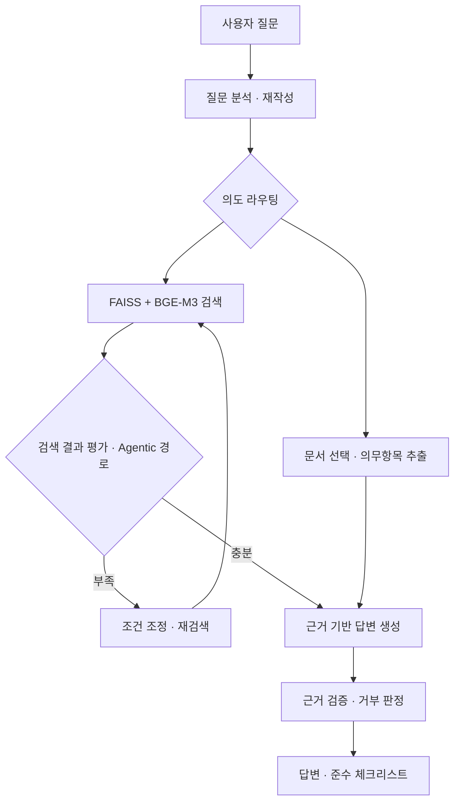
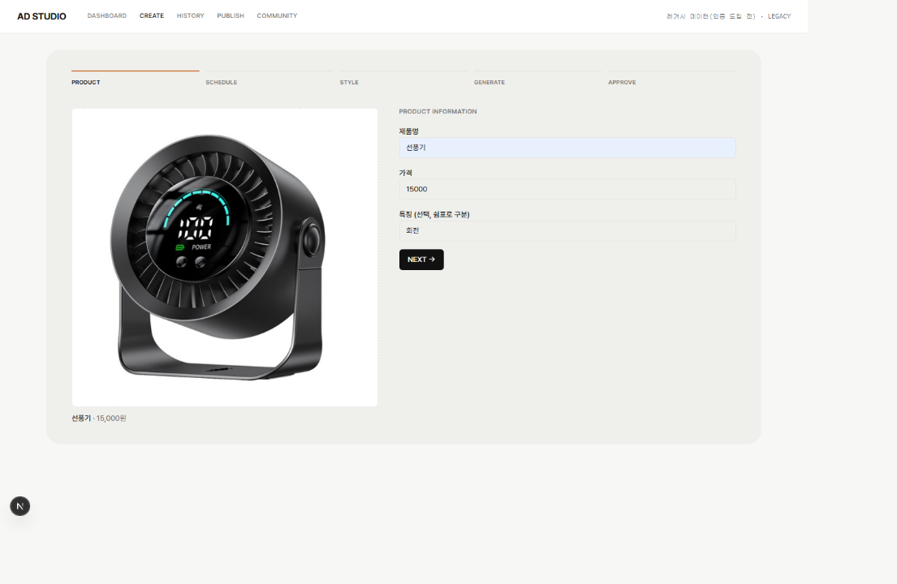
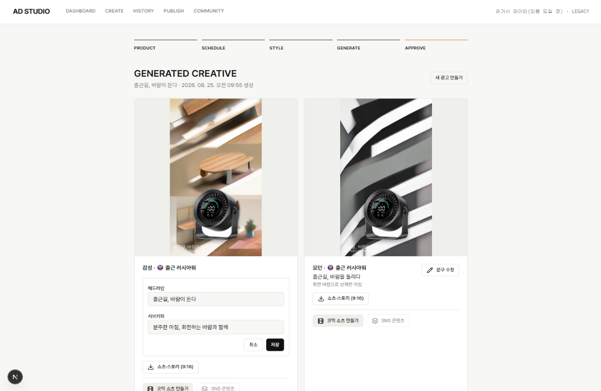
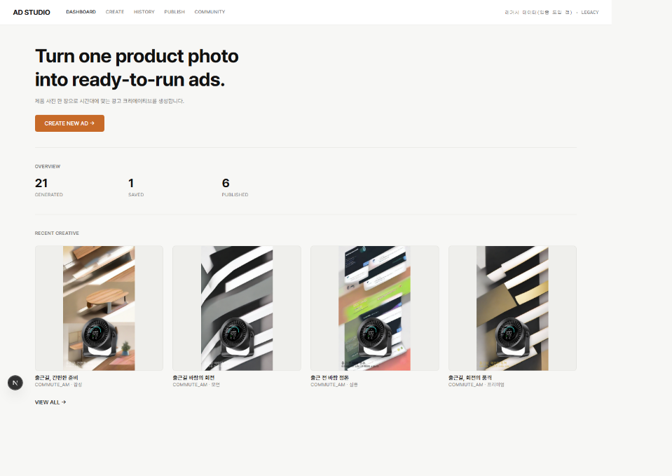
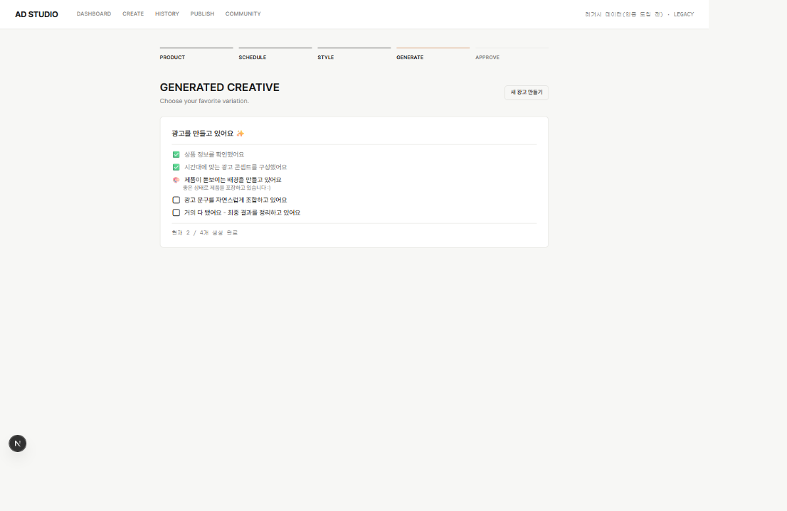
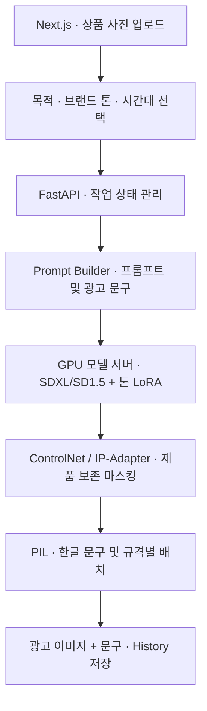

# Kim Jaeheon · AI Engineer

### 문서 검색부터 객체 탐지, 이미지 생성까지 — AI 모델을 사용자가 만나는 서비스로 연결합니다.

RAG · Computer Vision · Generative AI

## Projects

### 01. RFP 문서 요약 & 질문/답변 챗봇 · RFPilot

공공입찰 RFP 문서에서 필요한 정보를 검색하고, 근거 기반 답변과 의무사항 체크리스트를 제공하는 팀 프로젝트입니다.

**UI 화면**

의무사항 체크리스트 화면 보기

**파이프라인**

*저장소에 공개된 흐름을 요약했습니다. Naive 경로는 검색 후 재검색 루프 없이 답변을 생성합니다.*

**담당 기여** · Retrieval Engineer

- 임베딩 생성과 FAISS 인덱스 구축, 검색 기법 고도화
- 질문 재작성과 기관명 메타데이터 필터링을 통한 검색 개선
- Reranking·Multi-query 실험을 비교하고 최종 검색 구성을 선택

**검증 결과** · RFP 100건, 14,606개 청크. 저장소 보고 기준 검색 Hit Rate@5 **0.940**, Context Precision **0.848**. 생성 Faithfulness **0.905**는 별도 생성 평가 결과(골든 63건 중 비거부 50건)입니다.

`Python` `BGE-M3` `FAISS` `LangGraph` `FastAPI` `React`

[프로젝트 저장소 및 평가 상세](https://github.com/Codeit-Part3-5Team/codeit-part3-5team-project)

---

### 02. 이게머약 · 알약 객체 탐지

스마트폰으로 촬영한 이미지에서 알약을 탐지하고, 식약처 API로 효능·복용법·주의사항을 조회하는 팀 프로젝트입니다.

**UI 화면**

<table>
  <tr>
    <td align="center"> 홈 · 이미지 입력</td>
    <td align="center"> 알약 인식 결과</td>
  </tr>
</table>

**파이프라인**

**담당 기여** · PM · 모델 비교 및 데이터 처리 · 약품 API 연동

- RetinaNet 탐지 헤드를 클래스 수에 맞게 교체하고 비교 실험
- YOLO11s·11m 비교·튜닝과 최종 모델 선택에 참여
- 데이터 통합 과정의 JSON 덮어쓰기 문제를 하위 폴더 구조 보존으로 해결
- 식약처 제품허가정보 API를 우선 조회하고 e약은요 API로 정보 보완

**검증 결과** · 프로젝트 내부 검증 mAP@0.5 **0.9914**, F1 **0.9948**. 데이터 확장 전후 평가 클래스가 달라 동일 조건의 튜닝 개선치로 해석하지 않습니다.

`Python` `PyTorch` `YOLO11` `FastAPI` `Flutter` `식약처 Open API`

[프로젝트 저장소](https://github.com/jaeheonki/medicine-object-detection-project) · [시연 영상](https://youtu.be/b6sTlv_Z9cs)

---

### 03. Ad Creative Studio

소형가전 제품 사진을 입력받아 제품을 보존하면서 브랜드 톤·판매 시간대에 맞춘 광고 이미지와 문구를 생성하는 팀 프로젝트입니다.

**UI 화면**

제품 사진과 상품 정보를 입력한 뒤, 톤별로 생성된 광고를 비교하고 문구를 수정하는 실제 서비스 화면입니다.

**상품 입력** · 제품 사진, 제품명, 가격, 특징 입력

**광고 생성 결과** · 감성·모던 톤 결과 비교, 헤드라인·서브카피 수정 및 저장

대시보드 · 생성 진행 화면 보기

**대시보드** · 생성·저장·게시 현황과 최근 광고 확인

**생성 진행** · 작업 단계와 생성 완료 수 확인

**파이프라인**

*저장소의 서비스 흐름 중 광고 이미지 생성 경로를 요약했습니다.*

**담당 기여** · 추론 파이프라인 및 서빙 · 인프라

- ControlNet/IP-Adapter 추론 파이프라인 구성 및 추론 최적화
- GCP GPU VM·CUDA 환경 구축과 배포 담당
- GPU 모델 서버와 서비스 연동을 위한 서빙 환경 구성

`SDXL` `LoRA` `ControlNet` `IP-Adapter` `FastAPI` `Docker` `GCP` `CUDA`

[프로젝트 저장소](https://github.com/codeit-part4-team2/ad-creative-studio)

---

## Tech Stack

| 분야 | 기술 |
|---|---|
| 언어 | Python|
| 검색 · LLM | BGE-M3, FAISS, LangChain, LangGraph |
| Vision · 생성 모델 | PyTorch, YOLO, SDXL, LoRA, ControlNet, IP-Adapter |
| 서빙 · 인프라 | FastAPI, Docker, GCP, CUDA |
| 도구 | OpenAI API, Hugging Face |
| 협업| Git, GitHub |

RFPilot·이게머약 화면과 팀 성과는 연결된 원본 저장소를 출처로 사용했습니다. Ad Creative Studio 화면은 직접 제공한 서비스 캡처입니다. 개인 담당 범위는 각 프로젝트의 기여 항목에 구분했습니다.
