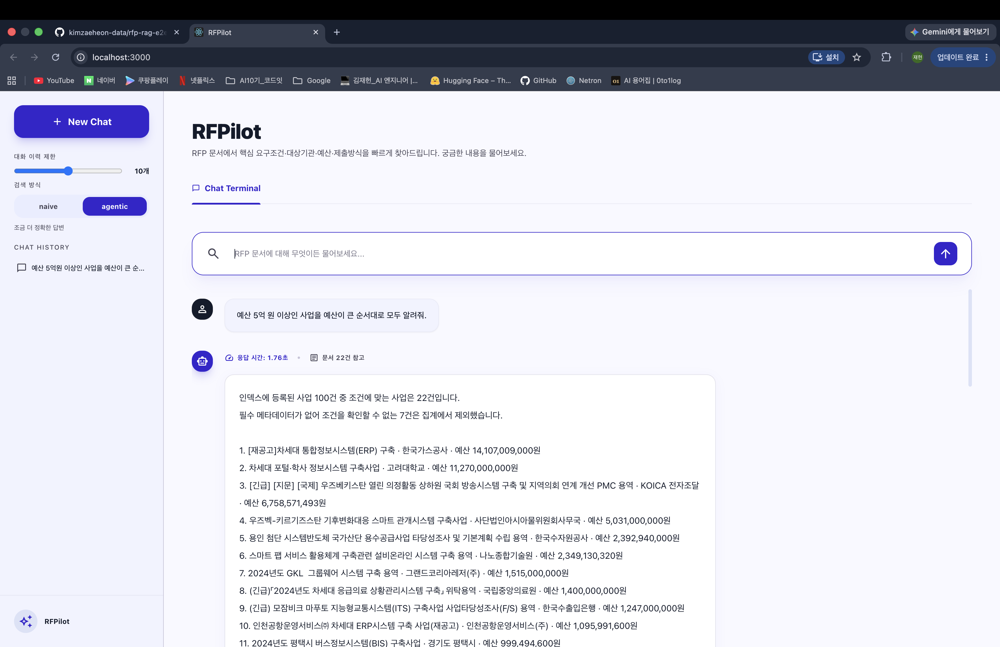
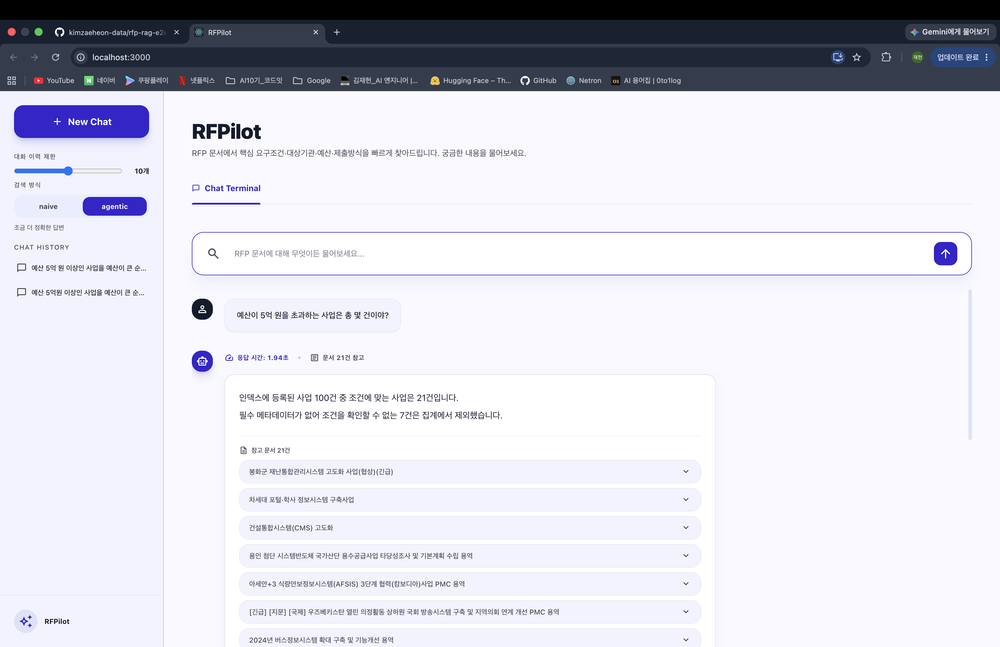
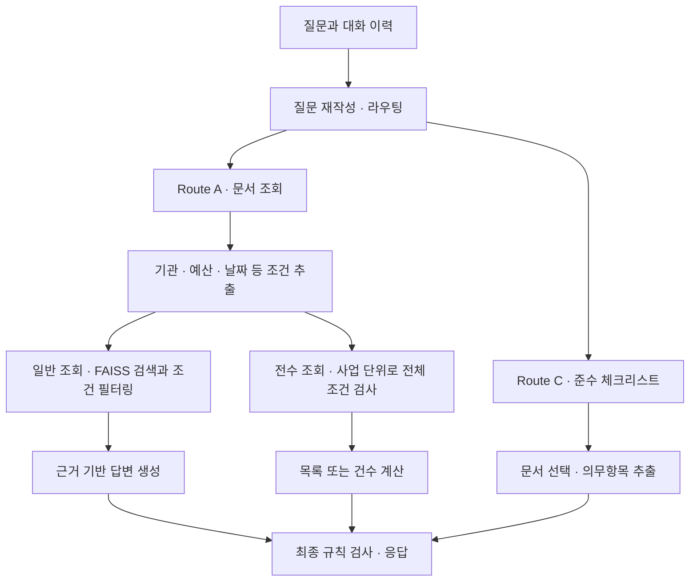
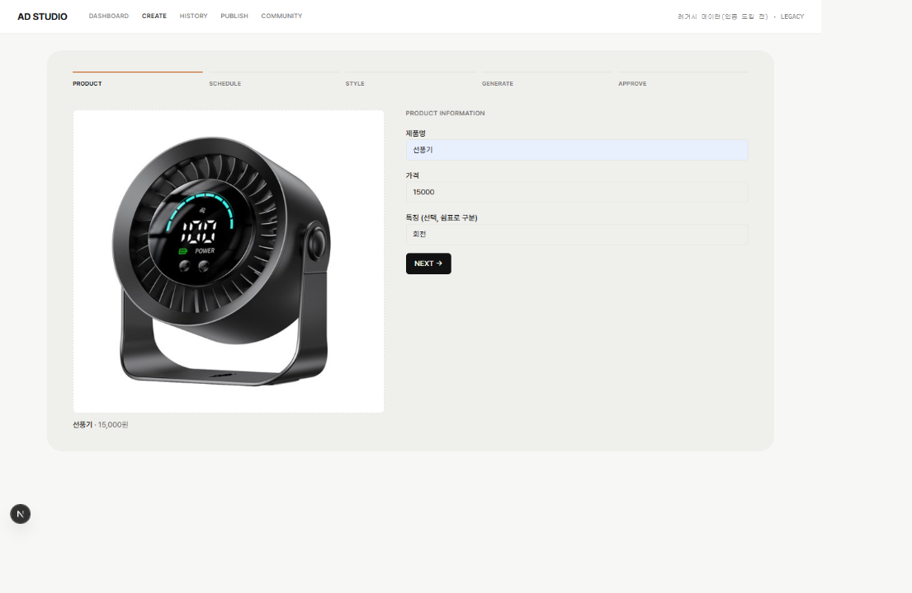
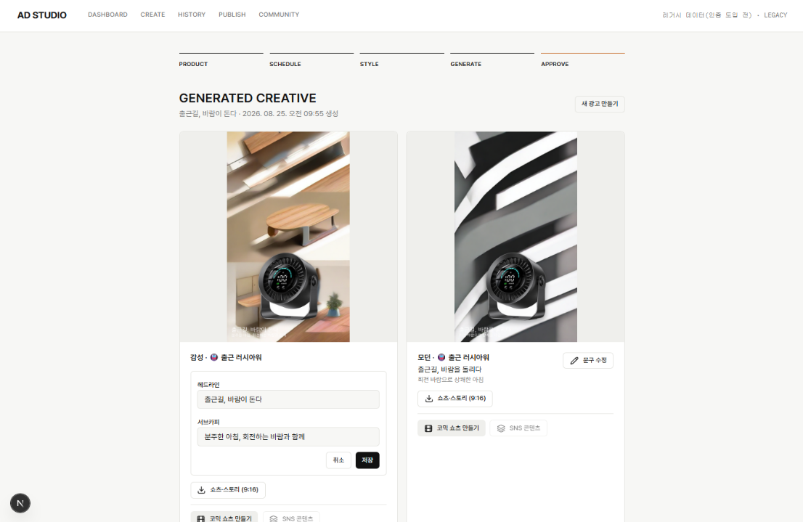
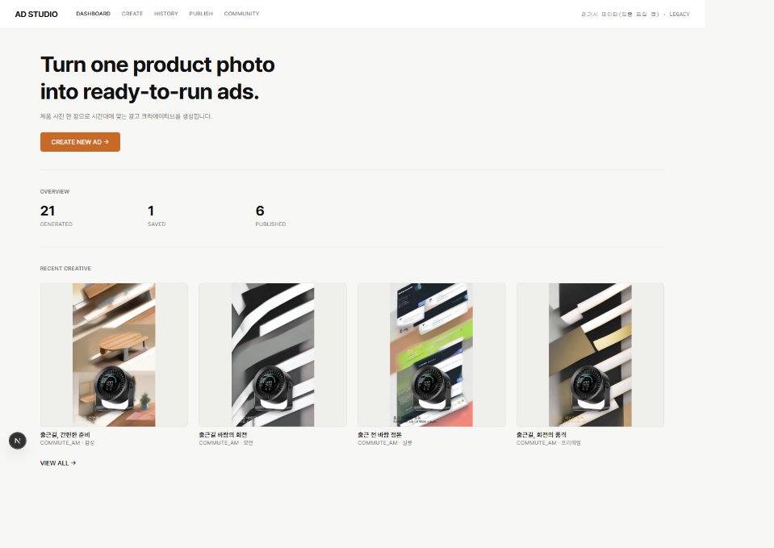
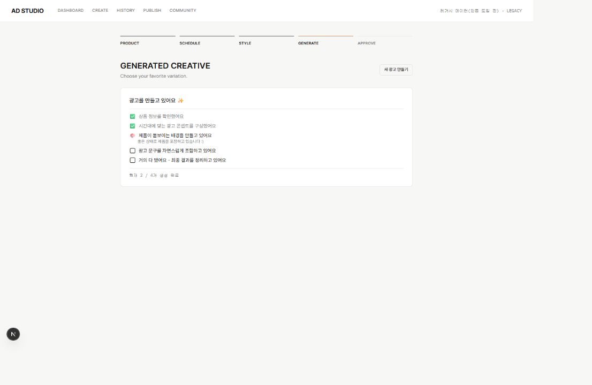
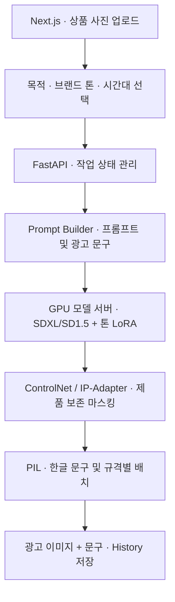

# Kim Jaeheon · AI Engineer

### 실험과 검증을 통해 AI 모델을 개선하고 서비스로 연결하는 AI 엔지니어

검색 품질 개선 · 모델 비교·평가 · 추론 파이프라인 및 서빙

## Projects

### RFPilot · 공공조달 RFP 챗봇 개인 고도화

공공조달 제안요청서(RFP)에서 근거 문서를 찾아 답변하고 의무사항 체크리스트를 만드는 챗봇입니다. 팀 프로젝트에서 BGE-M3 임베딩과 FAISS 검색을 구축하고 검색 품질을 평가했습니다. 프로젝트를 마친 뒤 검색 평가 코드와 실제 챗봇의 요청 경로를 비교해 두 가지 문제를 찾아, 이를 개선하는 개인 고도화를 진행했습니다.

**UI 화면**

실제 RFP 100건의 전체 14,606개 청크 인덱스를 사용한 로컬 서비스 화면입니다.

**전수 조회 · 예산 5억 원 이상인 사업 22건**

*조건을 충족한 22건을 모두 반환하고, 예산 정보가 없어 조건을 확인할 수 없는 7건은 별도로 안내합니다.*

**경계 조건 · 예산 5억 원 초과인 사업 21건**

*정확히 5억 원인 사업 1건을 제외해 21건으로 집계합니다. 예산 미확인 7건은 별도로 안내합니다.*

**파이프라인**

일반 조회는 Naive 모드에서 검색 후 생성으로 넘어가고, Agentic 모드에서는 검색 결과를 평가하고 필요할 때 재검색합니다.

**개인 고도화 및 검증**

- **챗봇의 답변용 검색에 메타데이터 필터 적용**. 검색 평가에서 사용하던 기관·예산·날짜 필터가 챗봇의 최초 검색에 빠져 있었습니다. 최초 검색에 필터를 연결하고 재검색에서도 질문에 명시된 조건을 유지했습니다. RFP 100건에서 추출한 사업 정보 요약 인덱스와 평가 질문 6개로 비교한 결과, 정답 문서가 검색 1위에 나온 질문은 **3/6 → 6/6**, 평균 정답 문서 재현율(Recall@5)은 **50.0% → 87.1%**였습니다. 평균 응답 시간은 **7.90초 → 10.44초**로 늘었습니다.
- **목록·건수 질문에 사업 단위 전수 조회 추가**. 유사도 검색 상위 5개만으로 답변을 만들면 조건을 만족하는 사업도 누락될 수 있었습니다. 전체 인덱스의 청크를 `doc_id`로 묶어 사업별 메타데이터에 조건을 적용하고, Top-K 제한 없이 일치하는 사업의 목록이나 건수를 반환하도록 분리했습니다. 실제 서비스 화면에서 예산 5억 원 이상인 **22건**, 5억 원 초과인 **21건**을 확인했고, 예산 미확인 7건은 별도로 안내했습니다.
- **실제 API 종단간 평가로 조건 추출기 개선**. 전체 **14,606개 청크·사업 100건**의 FAISS 인덱스와 실제 `/chat` 경로에서 평가했습니다. 실패 원인을 분석해 JSON 출력 스키마를 적용하고, 조회 범위 판정과 초과·미만의 경계 계산을 코드로 옮겼습니다. 전수 조회 회귀 질문 24개의 종단간 성공은 **17/24 → 24/24**, 평균 요청 처리 시간은 **6.726초 → 1.281초**, API 타임아웃은 **2건 → 0건**이었습니다.

*6문항 검색 비교와 24문항 전수 조회 평가는 별도 실험입니다. 24문항 결과는 개선 과정에서 사용한 동일한 회귀 세트를 버전별로 한 번씩 실행한 수치이며, 평균 시간은 사전 로딩을 제외하고 실패 요청을 포함합니다. 새로운 질문과 반복 실행, 일반 검색·답변 생성 및 다중 대화는 추가 검증이 필요합니다.*

`Python` `BGE-M3` `FAISS` `LangGraph` `FastAPI` `React`

[개인 고도화 저장소 및 실험 상세](https://github.com/kimzaeheon-data/rfp-rag-e2e) · [원본 팀 프로젝트](https://github.com/Codeit-Part3-5Team/codeit-part3-5team-project)

---

### 이게머약 · 알약 객체 탐지

스마트폰으로 촬영한 이미지에서 알약을 탐지하고, 식약처 API로 효능·복용법·주의사항을 조회하는 팀 프로젝트입니다.

**UI 화면**

<table>
  <tr>
    <td align="center"> 홈 · 이미지 입력</td>
    <td align="center"> 알약 인식 결과</td>
  </tr>
</table>

**파이프라인**

**담당 기여** · YOLO26n 모델 학습·최적화, DETR 실험 및 오분류 분석

- YOLO26n의 해상도·데이터 증강·Epoch·학습률·Optimizer를 조정하며 7차례 튜닝 실험 수행
- DETR 실험 및 오분류 사례 분석
- SGD와 초기 학습률 0.005를 적용해 담당 모델의 mAP@0.5 0.7118 → 0.9161로 개선

**팀 최종 모델 성과** · 팀에서 선정한 YOLO11s의 프로젝트 내부 검증 결과는 **mAP@0.5 0.9914, F1 0.9948입니다.** 위의 개인 담당 YOLO26n 실험과는 모델·평가 조건이 다르므로 직접 비교하지 않습니다.

**검증 결과** · 프로젝트 내부 검증 mAP@0.5 **0.9914**, F1 **0.9948**. 데이터 확장 전후 평가 클래스가 달라 동일 조건의 튜닝 개선치로 해석하지 않습니다.

`Python` `PyTorch` `YOLO11` `FastAPI` `Flutter` `식약처 Open API`

[프로젝트 저장소](https://github.com/jaeheonki/medicine-object-detection-project) · [시연 영상](https://youtu.be/b6sTlv_Z9cs)

---

### Ad Creative Studio

소형가전 제품 사진을 입력받아 제품을 보존하면서 브랜드 톤·판매 시간대에 맞춘 광고 이미지와 문구를 생성하는 팀 프로젝트입니다.

**UI 화면**

제품 사진과 상품 정보를 입력한 뒤, 톤별로 생성된 광고를 비교하고 문구를 수정하는 실제 서비스 화면입니다.

**상품 입력** · 제품 사진, 제품명, 가격, 특징 입력

**광고 생성 결과** · 감성·모던 톤 결과 비교, 헤드라인·서브카피 수정 및 저장

대시보드 · 생성 진행 화면 보기

**대시보드** · 생성·저장·게시 현황과 최근 광고 확인

**생성 진행** · 작업 단계와 생성 완료 수 확인

**파이프라인**

*저장소의 서비스 흐름 중 광고 이미지 생성 경로를 요약했습니다.*

**담당 기여** · 모델 서빙 및 GPU 인프라

- FastAPI 기반 추론 API와 Docker·GCP L4 GPU 서빙 환경 구축
- 전처리 캐싱 적용 및 생성 방식·Step·해상도별 추론 성능과 GPU 메모리 최적화 기법 비교
- 고품질 생성 방식에서 빠른 합성 방식으로 변경해 추론 시간 P50 17.47초 → 1.72초로 단축

`SDXL` `LoRA` `ControlNet` `IP-Adapter` `FastAPI` `Docker` `GCP` `CUDA`

[프로젝트 저장소](https://github.com/codeit-part4-team2/ad-creative-studio)

---

## Tech Stack

| 분야 | 기술 |
|---|---|
| 언어 | Python|
| 검색 · LLM | BGE-M3, FAISS, LangChain, LangGraph |
| Vision · 생성 모델 | PyTorch, YOLO, SDXL, LoRA, ControlNet, IP-Adapter |
| 서빙 · 인프라 | FastAPI, Docker, GCP, CUDA |
| 도구 | OpenAI API, Hugging Face |
| 협업| Git, GitHub |

RFPilot 화면은 개인 고도화 저장소의 데모이며, 이게머약 화면과 팀 성과의 출처는 원본 팀 저장소입니다. Ad Creative Studio 화면은 서비스 캡처입니다.
